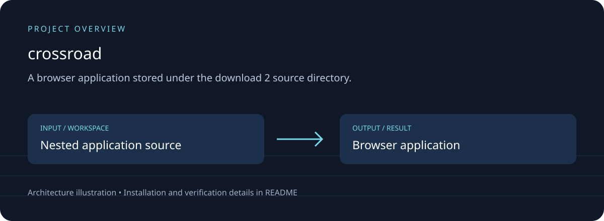

# crossroad

## Download, setup and project overview

A PHP web application stored under the `download 2` source directory.

PHP controllers, views, authentication middleware and database configuration are stored together under `download 2`.



[Download source ZIP](https://github.com/ahpa5246-lgtm/crossroad/archive/refs/heads/main.zip) · [Changes and branches](https://github.com/ahpa5246-lgtm/crossroad/branches) · [Verification notes](docs/QUALITY_REVIEW.md)

The ZIP contains source code. Installation steps and external runtime requirements are listed below.

```bash
git clone https://github.com/ahpa5246-lgtm/crossroad.git
cd crossroad
```

From the repository directory:

```text
# Requires PHP with PDO SQLite and a writable local database directory.
# Review download 2/config/Config.php and use local development settings.
cd "download 2"
php -S 127.0.0.1:8080
```

The diagram is a project illustration. Test results and runtime limitations are recorded in [the review](docs/QUALITY_REVIEW.md); it is not a production-readiness certification.


A PHP web application stored under the `download 2` source directory.

PHP controllers, views, authentication middleware and database configuration are stored together under `download 2`.
